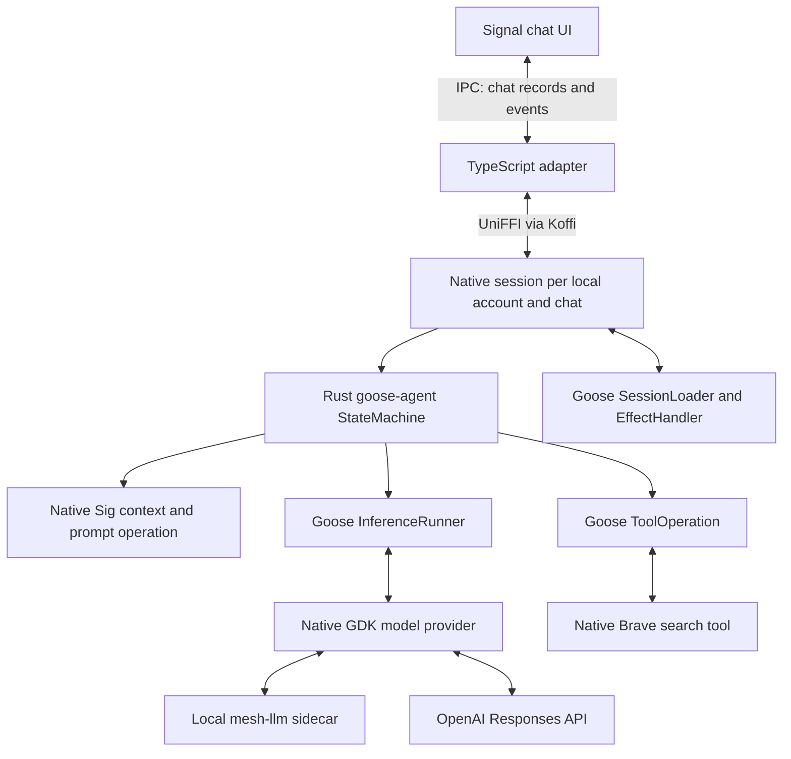

# Native Goose agent in sig demo

Sig demo embeds the published **`goose-agent` 0.1.0-alpha.12** crate in the
Electron main process. Its real `StateMachine`, `InferenceRunner`, and
`ToolOperation` manage each query. The application exposes that runtime through
**UniFFI 0.32.2**, called from TypeScript using **Koffi 3.3.3**.

## Responsibilities

Signal reads eligible text records from its own chat database and supplies the
current question, display name, recent candidate messages, and current date.
It excludes deleted/expired messages, attachments, unfinished Sig replies, and
messages outside the chat or after the question. The IPC boundary permits up to
60 candidate records within a transport byte limit. Stable record IDs accompany
the records so Rust can reconcile the current snapshot with earlier turns.

The **native agent** selects the actual context window: up to 12 recent messages,
6,000 UTF-8 bytes including authors, with each entry bounded to 1,500 bytes.
It normalizes display names, preserves useful message tails, constructs Sig's
system/tool prompts, and seeds the state-machine conversation. Prior chat is
quoted background data; the current question is identified explicitly.

Each local account and chat has a reusable native `SigAgentSession`. It retains
the official Goose conversation through `SessionLoader` and `EffectHandler`;
a per-session mutex serializes turns. Different chats can run independently.
Every turn has its own cancellation token, provider configuration, and search
budget. Changing inference provider preserves the chat session identity.

Signal remains the source of chat history. Before every turn, Rust rebuilds the
model context from the newly supplied eligible window. Data that was deleted,
expired, edited, or excluded from that window cannot survive through an older
cached transcript. Eligible prior locally generated Sig replies remain native
assistant messages in chronological order; other chat records remain quoted
background data. Up to 2 KB of neutral Brave excerpts can accompany the window
only while both the originating query and completed Sig reply still have matching
record IDs and text in that window. Rust does not replay old provider-specific
tool metadata across turns or providers. Account, chat, query, and reply IDs are
local bookkeeping and never enter the model prompt. Agent sessions live only in
memory; there is no separate on-disk agent history.



The TypeScript adapter forwards native text, status, timing, and terminal events.
It does not build model prompts, execute tools, or request model continuations.

## Native integration

- `native-agent/src/lib.rs` defines the application UniFFI interface: create an
  account/chat-scoped `SigAgentSession`, run it with the current configuration and
  request, then consume its owned stream with `next_event`, `cancel`, and
  asynchronous `shutdown`. Synthetic warmup remains a separate ephemeral run.
- `native-agent/src/runtime.rs` registers native operations and calls the
  upstream `StateMachine::run`. Session loading and effect application retain the
  native conversation between invocations, reconciled against Signal's current
  eligible context window.
- `native-agent/src/context.rs` owns context selection and prompt contributions.
- `native-agent/src/brave.rs` calls Brave's LLM Context endpoint directly from
  Rust with bounded results and a local credential. Goose's `ToolOperation`
  executes it. ChatGPT uses OpenAI's built-in search instead.
- `native-agent/src/compat_provider.rs` preserves the observed mesh tool-call
  aliases and text-format compatibility while retaining provider metadata.
- Native limits permit at most two searches and three model turns. Another
  model request requires a newly completed search; ordinary answers use one.
  No inference is sent as an agent-planning preflight.
- Free-mesh warming is a native warmup mode sharing the same prompts and tool
  schema. Paid mesh is connected without a synthetic inference warmup.

The mesh sidecar still owns discovery, routing, wallet state, and payments.
The native agent only calls its loopback inference endpoint. The approved
private demo keys remain in the packaged runtime configuration; mesh requests
do not receive an OpenAI key, and the Brave key is sent only to Brave.

## Bindings and build

`uniffi-runtime.node.ts` and `codec.node.ts` implement UniFFI buffers, records,
enums, opaque object handles, and Rust futures. The codec copies returned
buffers into V8-owned memory before freeing Rust memory, as required by
Electron's V8 memory cage. Each namespace validates the native contract and
interface checksums before calls are made.

`agent-bindings.node.ts` is the typed facade for `libsig_demo_agent.dylib`,
including owned session and stream handles.
`bindgen/src/main.rs` uses official `uniffi_bindgen` metadata extraction;
`generate-types.node.mjs` generates `generated-agent/` types and ABI metadata.
These descriptors come from the actual native library.

The session/stream API below is our small application UniFFI facade. Inside it,
Rust uses Goose's actual `SessionLoader`, `EffectHandler`, and `StateMachine`
interfaces; these are not TypeScript implementations of Goose's state machine.
The main process retains the session handle across questions:

```ts
const sessions = new Map<string, SigAgentSession>();
const key = JSON.stringify([accountId, chatId]);
let session = sessions.get(key);
if (!session) {
  session = bindings.createSession(accountId, chatId);
  sessions.set(key, session);
}
const chatSession = session;

async function runTurn(config, request, onEvent) {
  const stream = await chatSession.run(config, request);
  try {
    for (let event; (event = await stream.nextEvent()) !== null; ) {
      onEvent(event);
    }
  } finally {
    await stream.shutdown();
    stream.dispose();
  }
}

await runTurn(firstConfig, firstRequest, onEvent);
await runTurn(nextConfig, followUpRequest, onEvent); // Same native session.

// After cancelling and draining active runs on account change, window close,
// or app quit, dispose the retained handles and clear the app's cache.
for (const retained of sessions.values()) retained.dispose();
sessions.clear();
```

Each request carries the current query/reply record IDs, source text, and a fresh
Signal history snapshot. The stable local account/chat scope belongs to the
session handle, while the inference configuration belongs to each run.

Build with Rust 1.95.0 and Node 24.21.0:

```sh
sh sig-demo/gdk/build-native.sh
```

The script also retains the original provider-only SDK library and bindings for
development smoke checks. The app loads and packages the native agent library
under `Resources/sig-demo-gdk/libsig_demo_agent.dylib`.

The provider-types vendor patches preserve OpenAI Responses built-in search and
citations, and assemble streamed tools across paid mesh's intermediate billing
usage frames. See `native/vendor/goose-provider-types/SIG_DEMO_PATCH.md`.

## Cancellation and verification

An `AbortSignal` cancels the pending UniFFI future and signals the native agent.
The adapter awaits native `shutdown()` before disposing its stream or completing
the request. Provider switching therefore waits for native work to release its
I/O before changing the mesh process or spending policy, while preserving the
account/chat session. Account changes and window closure clear the local
session handles. `Drop` provides an abort fallback. Loaded libraries and
registered callbacks remain alive for the process lifetime.

Tests use synthetic local model responses and fake credentials. Rust checks
cover native tools and state-machine behavior; Node/Electron checks exercise
the compiled library through the actual TypeScript UniFFI bindings. No paid
inference is needed for these checks.

```sh
pnpm run demo:test
cargo +1.95.0 test --locked --manifest-path sig-demo/gdk/native-agent/Cargo.toml
pnpm run demo:agent:test:native
pnpm run demo:agent:test:electron
```

References: [GDK overview](https://goose-docs.ai/docs/gdk/),
[Goose agent state machines](https://goose-docs.ai/blog/2026/09/16/agentic-state-machines/),
[UniFFI async FFI](https://mozilla.github.io/uniffi-rs/latest/internals/async-ffi.html).
